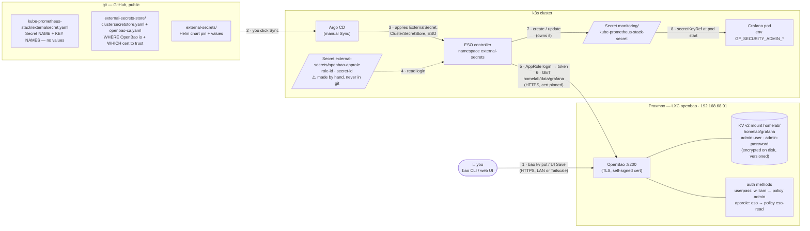
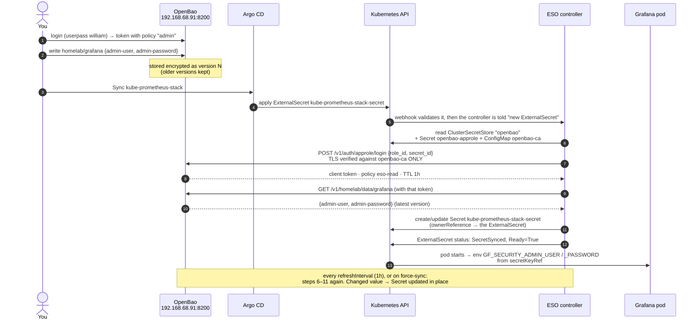
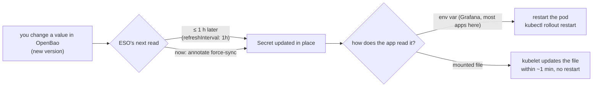
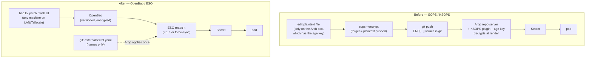

# OpenBao — where secrets live

> **Status (Nov 2026): done — this is the only secrets system.** OpenBao runs on a Proxmox LXC
> (`192.168.68.91`). External Secrets Operator is deployed and the cluster's connection is `Valid`.
> **On OpenBao:** Grafana (`homelab/grafana`), Wealthfolio, degoog, Immich, Karakeep, Homepage and
> qBittorrent (each `homelab/<app>`).
> **SOPS + age + KSOPS is retired.** qBittorrent was the last app; with it went the repo-server tool
> overrides, `.sops.yaml`, `scripts/secrets.sh` and the CI secrets check. The old guides are in
> `../archive/secrets-sops.md` and `../archive/secrets-architecture-sops.md`.
> Komf, RomM and Ghostfolio were removed (Nov 2026).
>
> **New here? Read §11 "How it works, end to end" first**: diagrams plus one value followed from
> OpenBao to the pod.

This doc explains **what** was set up and **why each piece is the way it is**, in enough detail that you
could rebuild it from nothing, or decide to change it, without guessing.

---

## 1. Why we're replacing SOPS

SOPS kept a copy of every secret **in git, encrypted**. That model is sound, but the way it worked here
kept biting:

| What kept going wrong | Root cause |
|---|---|
| "I encrypted it, but the file is still plaintext" | the age **private** key lives only on the Arch box. Any other machine (the Mac) can't encrypt-and-verify or decrypt, so you end up with two copies of a file in different states |
| a template with `REPLACE_ME` got committed | every secret is born as a plaintext file you must remember to encrypt before `git add` |
| `MAC mismatch` / "secret not found" at Sync | an encrypted file was edited by hand, or the KSOPS generator wasn't wired into `kustomization.yaml` |
| Argo needed special surgery | the repo-server is patched to carry `ksops` + `kustomize` + the age key (`bootstrap/argocd/repo-server-ksops-patch.yaml`) |

The new model removes the class of problem instead of patching each one:

> **Secret values never touch git at all.** Git only says *where* a value lives
> ("Grafana's admin password is at `homelab/grafana`, key `admin-password`"). The value itself lives
> in OpenBao, and a controller in the cluster fetches it.

No keys on laptops, nothing to encrypt, no plaintext copies to forget, and a stock Argo CD.

### Why OpenBao and not something else
Researched Nov 2026 (sources in the conversation that produced this doc):

| Option | Verdict |
|---|---|
| **OpenBao** ✅ | Truly open source (MPL-2.0, Linux Foundation): no paid tier, no license key, nothing feature-gated. A fork of HashiCorp Vault, so Vault's docs, tooling and External Secrets' **most mature provider** all apply. One small binary |
| Infisical | Friendlier UI, but **open-core**: a proprietary `ee/` tree needs a license key that phones home. Audit logs, rotation and SSO are paid. Heavy (~1 GB idle + Postgres + Redis) and churns fast (several releases a week) |
| Sealed Secrets | Removes KSOPS but keeps the "run a CLI to encrypt every change" step, you can't read a value back out of git, and you must back up the cluster's private key or lose everything on a rebuild |
| Cloud managers (Doppler, 1Password, Bitwarden SM) | Work, but put the keys to everything with a third party, and some need paid plans for machine access |

---

## 2. Where it runs, and why there

```
┌─ Proxmox ─────────────────────────────────┐        ┌─ k3s ──────────────────────────────────────┐
│  LXC "openbao"  https://192.168.68.91:8200│        │  External Secrets Operator (ESO)           │
│    /opt/openbao  storage (encrypted)      │◄─HTTPS─┤    logs in with AppRole (read-only)        │
│    unlock key + root token: openbao.env   │  LAN   │    reads homelab/<app> → writes a normal   │
│    backed up by Proxmox (vzdump)          │        │    Kubernetes Secret → the pod, as today   │
└───────────────────────────────────────────┘        └────────────────────────────────────────────┘
```

**On Proxmox, never inside k3s.** A secret store inside the cluster it serves creates a chicken-and-egg
problem. Rebuild the cluster and the apps need the store, but the store is one of the things being
rebuilt, and it has secrets of its own. You'd be hand-creating secrets to start the secret manager.
Outside the cluster it's like the Postgres (.7) and Valkey (.103) LXCs: **things the cluster depends on
live outside it**, survive a rebuild untouched, and get Proxmox backups for free.
(The full flow, with diagrams: §11.)

### Access: LAN and Tailscale, never the tunnel
| Who | How | Why |
|---|---|---|
| the cluster (ESO) | `https://192.168.68.91:8200`, straight over the LAN | secrets must not depend on DNS, Traefik, Cloudflare or the tunnel being up — the same rule that keeps Bark alerts in-cluster |
| you, at home | the same address in a browser (accept the self-signed cert) | — |
| you, away | Tailscale (the community scripts' `add-tailscale-lxc.sh` add-on, run on the Proxmox host, then `tailscale up` in the LXC) | reach it from anywhere with no public exposure |

**Not through the Cloudflare tunnel / NPMplus.** The tunnel is for things that must work from the
internet (Argo's webhook path, Bark registration, Immich share links). Nothing about secrets needs that,
and publishing the login page would let anyone try passwords against the one box that holds every key.
If it ever has to be public, put a Cloudflare Access policy in front — never the raw port.

**Installed with the community script** (`community-scripts/ProxmoxVE` → `ct/openbao.sh`): a Debian 13
unprivileged LXC, 1 CPU / 1 GB / 4 GB, OpenBao from its official GitHub release `.deb`.

### What the install script did for you (and why it matters)
| It did | Consequence |
|---|---|
| started OpenBao with a **self-signed TLS** certificate on `:8200` | your browser warns. ESO must be told to trust that cert (§7), or connect fails. Replaced in §5 step 6 with one that names the IP |
| ran `bao operator init -key-shares=1 -key-threshold=1` | created the storage's master key, split into **1** unlock key (more on this in §3) and a **root token** |
| wrote `BAO_UNSEAL_KEY` and `BAO_ROOT_TOKEN` to `/etc/openbao/openbao.env` (mode 600, root) | both are on the box's disk. See §4 for why that's an acceptable trade here, and what it costs |
| added a systemd drop-in: `ExecStartPost=bao operator unseal ${BAO_UNSEAL_KEY}` | OpenBao **unlocks itself on every start**. Without this, every reboot of the LXC would leave it locked until you typed the key |

---

## 3. The concepts, briefly (you'll see these words everywhere)

**Sealed / unsealed.** Everything OpenBao stores on disk is encrypted. At start it doesn't know the key,
so it is **sealed**: running, but unable to read or serve anything. **Unsealing** gives it the key. Vault's
default is to split that key into 5 pieces and require 3 (Shamir's secret sharing), so no single person
can unlock it alone. That's right for a company and pointless for one person, hence `shares=1
threshold=1`. Check with `bao status` → `Sealed: false`.

**Root token.** Created once at init. It can do *anything*, bypassing every policy. Use it to set things up,
then put it away (§5 step 5 gives you a normal login).

**Tokens.** Everything in OpenBao is done *with a token*. Logging in (with a password, an AppRole, …)
just means trading credentials for a token with certain **policies** and a **TTL** (time to live).

**Policies.** Plain-text rules: "this token may `read` paths under `homelab/data/*`". No policy = no access.
Policies are how ESO gets read-only access while you get full access.

**Auth methods.** Different ways to log in and get a token: `token` (paste one), `userpass` (username +
password, for humans), `approle` (a role-id + secret-id pair, for machines), `kubernetes` (pods prove who
they are with their service account), and more.

**Secrets engines** are mounted at a path. We use **KV v2** (key-value, version 2) mounted at `homelab/`.
KV v2 keeps **version history**: every write is a new version, and old ones can be read or restored. Its
quirk: the API inserts `data/` and `metadata/` into paths, so `bao kv get homelab/grafana` really reads
`homelab/data/grafana`. That's why the policy below names `homelab/data/*`.

---

## 4. The security trade-offs, stated honestly

| Choice | What it costs | Why it's acceptable here |
|---|---|---|
| unlock key on the LXC's disk (auto-unseal) | anyone with a copy of the LXC (or its backup) can unlock it | the alternative is typing the key after every reboot, which is exactly the kind of recurring hassle this migration exists to remove. Infisical would keep its `ENCRYPTION_KEY` on its own box the same way. **So protect the backups**: they're as sensitive as the secrets |
| root token on disk | anyone with root on the LXC has full control | root on that LXC already means game over (they could read the unlock key). Optional hardening: revoke it after setup (§9) |
| self-signed TLS | no browser trust; ESO needs the cert pinned | it's LAN-only. Traffic is still encrypted, and pinning the exact cert in ESO is *stronger* than trusting any public CA |
| one node, no HA | if the LXC is down, no **changes** reach the cluster | already-created Kubernetes Secrets keep working. Apps don't notice an OpenBao outage, only new or changed secrets wait. Gatus will watch it |

**Where the keys must also live:** `BAO_UNSEAL_KEY` and `BAO_ROOT_TOKEN` in your password manager. If
the LXC's disk dies and the backup's `openbao.env` is gone too, the unlock key is the only way to ever
read the data again.

---

## 5. The one-time setup, step by step

Run in the LXC's console (Proxmox → the container → Console, log in as `root`).

### Step 1 — act as root in the CLI
```bash
source /etc/openbao/openbao.env && export BAO_TOKEN="$BAO_ROOT_TOKEN"
```
`openbao.env` sets `BAO_ADDR=https://127.0.0.1:8200` and `BAO_SKIP_VERIFY=true` (the CLI tolerates the
self-signed cert *from the box itself*) and holds the root token. The `bao` CLI reads `BAO_TOKEN` for
every command, so this logs the shell in as root. It lasts only for this shell session.

### Step 2 — a key-value store called `homelab`
```bash
bao secrets enable -path=homelab -version=2 kv
```
- **`kv` version 2:** the version history (§3). Overwrite a password by mistake and you can still read
  the old one with `bao kv get -version=N homelab/grafana`.
- **`-path=homelab`:** one mount for the whole homelab, one entry per app: `homelab/grafana`,
  `homelab/wealthfolio`, `homelab/karakeep`, … Each entry holds that app's keys, mirroring today's one-Secret-per-app layout.

### Step 3 — a read-only login for the cluster
```bash
bao policy write eso-read - <<'EOF'
path "homelab/data/*"     { capabilities = ["read"] }
path "homelab/metadata/*" { capabilities = ["read", "list"] }
EOF
bao auth enable approle
bao write auth/approle/role/eso token_policies=eso-read token_ttl=1h token_max_ttl=4h secret_id_ttl=0 secret_id_num_uses=0
```

**The policy `eso-read`.** Least privilege: ESO can read values (`data/*`) and list entries
(`metadata/*`), but never create, change or delete. If the cluster were ever compromised, the attacker
could read the homelab secrets (the cluster needs those anyway), but couldn't overwrite them or touch
anything outside `homelab/`.

**Why AppRole** for ESO, out of the options ESO supports:

| Option | Why not / why |
|---|---|
| a plain token | tokens expire. A non-expiring token means a root-made credential that never rotates, and ESO doesn't renew static tokens |
| `kubernetes` auth | the most "proper", but OpenBao must then call the k3s API to verify pod identities, so it needs a reviewer token, the cluster CA and network access to the API server. More moving parts across two machines, and it breaks on a cluster rebuild |
| **AppRole** ✅ | a machine username/password: **role-id** (not very secret, identifies the role) + **secret-id** (the secret). ESO logs in with them whenever it needs to and gets a **short-lived token**. One credential, created once, survives a cluster rebuild unchanged |

**The flags on the role:**
- `token_policies=eso-read`: every token ESO gets carries only the read-only policy.
- `token_ttl=1h` / `token_max_ttl=4h`: each login's token dies within hours. A leaked *token* is useless
  quickly; ESO simply logs in again.
- `secret_id_ttl=0` / `secret_id_num_uses=0`: the *secret-id* itself never expires and can be reused. That's
  a deliberate homelab choice: an expiring secret-id would silently stop secret delivery one day and need
  re-issuing. The trade is that the secret-id is a long-lived credential, which is why it lives only in
  your password manager and in one hand-made Kubernetes Secret.

### Step 4 — print the cluster's credentials
```bash
bao read -field=role_id auth/approle/role/eso/role-id; echo
bao write -f -field=secret_id auth/approle/role/eso/secret-id; echo
```
- The **role-id** is fixed for the role. You can re-read it any time.
- Each `write …/secret-id` **mints a new** secret-id (old ones keep working unless revoked). If you lose
  it, just mint another. To cut one off: `bao write auth/approle/role/eso/secret-id/destroy secret_id=…`.
- Save both in the password manager. They go into the cluster **once, by hand** (§7), the only
  hand-made secret in the whole design. That's the irreducible "secret zero": something has to prove
  the cluster is allowed in, and it can't come from OpenBao itself.

### Step 5 — an everyday admin login for you
```bash
bao policy write admin - <<'EOF'
path "*" { capabilities = ["create", "read", "update", "delete", "list", "sudo"] }
EOF
bao auth enable userpass
read -rs -p "New admin password: " PW; echo
bao write auth/userpass/users/william password="$PW" token_policies=admin; unset PW
```
- Using the root token day to day is like logging in as root for everything: it works, but there's no
  difference between "me" and "the master key". `userpass` gives you a normal username + password login.
  In the web UI, pick Method **Username**.
- `admin` grants everything, `sudo` included (some system paths require it). It's *your* account, so full
  power is the point; the difference from root is that it's a revocable, separate identity.
- `read -rs` asks for the password without echoing it, and keeps it out of shell history and the screen.
  `unset PW` clears it from the shell afterwards.

### Step 6 — a certificate that names the IP (done 2026-11-05)
ESO connects to `https://192.168.68.91:8200`. TLS verification passes only if the certificate **names
that IP** in its Subject Alternative Names (SANs) **and** ESO trusts the certificate. Rather than inspect
what the script generated, it was replaced with one that is known-good:
```bash
CERT=$(grep -oP 'tls_cert_file\s*=\s*"\K[^"]+' /etc/openbao/openbao.hcl)
KEY=$(grep -oP 'tls_key_file\s*=\s*"\K[^"]+' /etc/openbao/openbao.hcl)
cp -p "$CERT" "$CERT.bak"; cp -p "$KEY" "$KEY.bak"
openssl req -x509 -newkey rsa:2048 -nodes -days 3650 -subj "/CN=openbao" \
  -addext "subjectAltName=IP:192.168.68.91,IP:127.0.0.1,DNS:openbao,DNS:localhost" \
  -keyout "$KEY" -out "$CERT"
chown --reference="$CERT.bak" "$CERT"; chmod --reference="$CERT.bak" "$CERT"
chown --reference="$KEY.bak" "$KEY";   chmod --reference="$KEY.bak" "$KEY"
systemctl restart openbao && sleep 3 && bao status | grep -E 'Sealed|Initialized'
```
- **SANs:** the LAN IP (what ESO uses), `openbao` (its Tailscale name, if added), localhost (the CLI in
  the LXC).
- **10 years**, so it doesn't quietly expire and cut the cluster off. Gatus warns 30 days before it does
  (`[CERTIFICATE_EXPIRATION] > 720h`), which is the reminder to re-run this.
- **Self-signed is fine here:** ESO doesn't trust "any valid cert", it trusts *this exact cert*, pinned in
  git as `kubernetes/apps/external-secrets/external-secrets-store/openbao-ca.yaml`. Regenerate it → paste
  it into that file → Sync `external-secrets-store`.
- If OpenBao won't start after this, put the `.bak` files back and restart.

---

## 6. Day-to-day (after the migration)

### In the web UI (nothing to install anywhere)
`https://192.168.68.91:8200` → **Method: Username** → `william` → your password.

**Create an entry** (a new app):
1. **Secrets Engines** → `homelab/` → **Create secret**.
2. **Path for this secret**: the app's path, e.g. `wealthfolio` (no `homelab/` prefix, no slashes).
3. One row per key → **Add**. Key names must match the app's `externalsecret.yaml` **exactly**
   (case, underscores, hyphens).
4. **Save**. That's version 1.

**Change one value:** open the entry → **Create new version** → edit the one field → **Save**. The form
starts from the current values, so the other keys are kept (it behaves like `patch`). Older versions:
**Version history** on the same page.

**A random value without a terminal** (passwords, keys, salts): **Tools** (in the menu) → **Random** →
*Number of bytes* (32 is right for most "secret key" settings) → *Output format* `base64` (or `hex` if
the app wants hex) → **Generate** → copy it into the entry's field. It's generated by OpenBao itself and
isn't stored anywhere. CLI equivalent: `bao write -field=random_bytes sys/tools/random/32 format=base64`.

**Never** paste a real password into an online "hash generator" or "random key" website. When an app wants
a **hash** of your password (e.g. Wealthfolio's Argon2), make it on one of your own machines: the OpenBao
LXC's console is fine (`apt install -y argon2` once). Per-app recipes are in the app's doc.

Then the cluster picks it up within the hour, or now with a force-sync (below), and the pod needs a restart.

### In the CLI
Add or change an app's secret:
```bash
bao kv put  homelab/grafana admin-user=admin admin-password='…'   # replaces ALL keys in the entry
bao kv patch homelab/grafana admin-password='…'                   # changes one key, keeps the rest
bao kv get  homelab/grafana                                        # read (current version)
bao kv get  -version=2 homelab/grafana                             # read an older version
bao kv rollback -version=2 homelab/grafana                         # make version 2 current again
```
⚠️ `put` replaces the whole entry. Forgetting a key in a `put` deletes it from the new version (it's
still in history). Use `patch` to change one value.

ESO notices the change within an hour (`refreshInterval: 1h`) and updates the Kubernetes Secret. To make
it happen now:
```bash
kubectl -n <ns> annotate externalsecret <app>-secret force-sync=$(date +%s) --overwrite
```
Pods that read the Secret as **env vars** need a restart to see it, exactly as with SOPS.

**A new key** for an app = put it in OpenBao **and** add it to the app's `externalsecret.yaml`:
```yaml
    - secretKey: NEW_KEY
      remoteRef: { key: <app>, property: NEW_KEY }
```
Key names are in git on purpose (values aren't): CI's secretrefs check (`check-conventions.sh` D) then
catches a Deployment asking for a key the ExternalSecret doesn't provide, before Sync does.

**A new app with a secret:** `bao kv put homelab/<app> KEY=…`, copy `externalsecret.yaml` from any app
(e.g. `kubernetes/apps/apps/wealthfolio/`), change name / namespace / path / keys, list it in
`resources:`.

---

## 7. The cluster side — External Secrets Operator

### What's in the repo
| Path | What | Why this way |
|---|---|---|
| `kubernetes/apps/external-secrets/external-secrets/` | ESO itself (Helm chart 2.14.0, pinned) + `rules.yaml` | the controller that turns "this Secret comes from homelab/x" into a real Secret. Needs ServerSideApply (its CRDs are ~700 KB), so it's in the ApplicationSet's `templatePatch` |
| `…/external-secrets/rules.yaml` | alert `ExternalSecretNotSynced` → Bark | fires when a Secret can't be refreshed for 15 min (OpenBao down/sealed, login revoked, key missing). Existing Secrets keep working meanwhile |
| `kubernetes/apps/external-secrets/external-secrets-store/` | the `ClusterSecretStore` named `openbao` + ConfigMap `openbao-ca` | the ONE place that says where OpenBao is, how to log in and which cert to trust. A separate app because its kind is defined by the CRDs above (same split as cert-manager → cert-manager-issuer) |
| `…/openbao-ca.yaml` | OpenBao's **public** certificate, as a ConfigMap | pinned trust. Public on purpose; the key never leaves the LXC. YAML rather than a `.crt` file because `.gitignore` ignores `*.crt`/`*.pem` |
| `<app>/externalsecret.yaml` (so far: `kube-prometheus-stack`, `wealthfolio`, `degoog`, `immich`, `karakeep`) | "build Secret `<app>-secret` from `homelab/<path>`, these keys" | same Secret **name and keys** as SOPS made, so no Deployment changed |
| `scripts/openbao-import.sh` | copies the **live** Secrets from the cluster into OpenBao | no age key needed, no typing values, can't import a stale file. Values go through pipes only, never printed |
| `openbao-approle` Secret (namespace `external-secrets`) | ESO's role-id + secret-id | **made by hand, not in git** — it's the key to OpenBao, so it can't come from OpenBao |

Secret → OpenBao path: converted = `grafana` (monitoring), `wealthfolio` (apps), `degoog` (apps), `immich` (media), `karakeep` (apps). Still to do, same pattern: `qbittorrent` — the import script knows it.

### Rollout — in this order
Each step depends on the one before it. Nothing in the cluster changes until you Sync.

**1. Put the certificate in git.** In the LXC console, print the *public* cert:
```bash
cat "$(grep -oP 'tls_cert_file\s*=\s*"\K[^"]+' /etc/openbao/openbao.hcl)"
```
Paste it into `kubernetes/apps/external-secrets/external-secrets-store/openbao-ca.yaml` under
`ca.crt: |`, replacing the three placeholder lines, **every line indented 4 spaces** (the
`-----BEGIN/END CERTIFICATE-----` lines included). Then commit + push.

**2. Re-apply the ApplicationSet** (adds ServerSideApply for `external-secrets`):
```bash
sudo k3s kubectl apply -f kubernetes/bootstrap/apps.yaml
```

**3. Sync `external-secrets`** in Argo. Wait for 3 pods Ready in namespace `external-secrets`.

**4. Give ESO its login.** In the LXC console (as root, step 1 of §5), print the role-id and mint a fresh
secret-id:
```bash
bao read -field=role_id auth/approle/role/eso/role-id; echo
bao write -f -field=secret_id auth/approle/role/eso/secret-id; echo
```
Then, where kubectl works, paste each when asked (nothing echoes, nothing lands in shell history):
```bash
read -rs -p "role-id: " RID; echo; read -rs -p "secret-id: " SID; echo
kubectl -n external-secrets create secret generic openbao-approle \
  --from-literal=role-id="$RID" --from-literal=secret-id="$SID"; unset RID SID
```
(On the master: `sudo k3s kubectl …`.)

**5. Sync `external-secrets-store`**, then check the connection:
```bash
kubectl get clustersecretstore openbao        # STATUS Valid, READY True
```
Not ready? `kubectl describe clustersecretstore openbao` — the message names the problem (§10).

**6. Copy Grafana's secret into OpenBao.** From a machine with kubectl, curl, jq and a route to `.91`:
```bash
./scripts/openbao-import.sh --dry-run grafana   # what it would copy: key NAMES only
./scripts/openbao-import.sh grafana             # asks for your OpenBao password, then copies
```
On the master: `KUBECTL="sudo k3s kubectl" ./scripts/openbao-import.sh grafana`. It copies the **live**
`kube-prometheus-stack-secret` (what Grafana uses today), skips a path that already exists (`--force`
to overwrite — the old version stays in history), and never prints a value. Check it landed:
`bao kv get homelab/grafana` (in the LXC, or anywhere `bao` is logged in).

- **`ERROR kubectl couldn't read …`** — kubectl itself failed (no kubeconfig / not root). On the master,
  prefix `KUBECTL="sudo k3s kubectl"`. (Older copies of the script printed this as `MISSING` too.)
- **`MISSING … not in the cluster`** — the Secret really doesn't exist, e.g. KSOPS never managed to
  build it, so the app isn't running either (this is what happened to Grafana in the pilot). Nothing to
  copy — create it in OpenBao instead, in the web UI or the CLI:

  **Web UI:** `https://192.168.68.91:8200` → sign in with *Username* `william` → **Secrets Engines** →
  `homelab/` → **Create secret** → path `grafana` → keys **exactly** as the ExternalSecret names them
  (`admin-user` = `admin`, `admin-password` = a new strong password, kept in your password manager) →
  **Save**.
  **CLI:** `bao kv put homelab/grafana admin-user=admin admin-password='…'`

  Grafana reads the password only on its FIRST start (then it lives in its database). If it had started
  before with another one: `kubectl -n monitoring exec deploy/kube-prometheus-stack-grafana -c grafana --
  grafana cli admin reset-admin-password '<new>'`.

**7. Sync `kube-prometheus-stack`** **with Prune ticked**. Check it:
```bash
kubectl -n monitoring get externalsecret      # kube-prometheus-stack-secret: SecretSynced, READY True
```
**`No resources found`** here means Argo hasn't applied the commit that adds `externalsecret.yaml` —
it's still on an older revision, or the last sync failed. Check which:
```bash
kubectl -n argocd get application kube-prometheus-stack \
  -o jsonpath='{.status.sync.status}{"  rev="}{.status.sync.revision}{"\n"}{.status.operationState.phase}{": "}{.status.operationState.message}{"\n"}'
```
Old `rev=` → in the Argo UI **Refresh** (or Hard Refresh) the app, then **Sync** with Prune. `Failed` →
the message says why. Pods "Running" doesn't prove the new version is live — they may be from before.

What happens to the old Secret: it has the same name, so ESO takes it over. If Argo still lists it as
"requires pruning" (it may still carry Argo's tracking label from the KSOPS days), the pruned Secret is
re-created by ESO within seconds. Running pods are unaffected either way; a pod that happened to restart
in those seconds retries on its own.

**8. Prove it round-trips.** Change something harmless and watch it arrive, e.g. the admin *user* name
is unused after first start (Grafana keeps logins in its database), so:
```bash
bao kv get -field=admin-user homelab/grafana
kubectl -n monitoring annotate externalsecret kube-prometheus-stack-secret force-sync=$(date +%s) --overwrite
kubectl -n monitoring get secret kube-prometheus-stack-secret -o jsonpath='{.data.admin-user}' | base64 -d; echo
```
Same value in both = OpenBao → ESO → Secret works.

### The migration — DONE (Nov 2026)
Every app was converted one PR at a time: Grafana first as the pilot, then Wealthfolio, degoog, Immich,
Karakeep, Homepage and finally qBittorrent, which was also the end of SOPS. The recipe, if you ever add
an app with a secret: create the OpenBao entry, add `externalsecret.yaml` listing the key names, list it
in `kustomization.yaml`, push, Sync.

### The cleanup — DONE (Nov 2026)
SOPS is gone: the KSOPS repo-server patch, `.sops.yaml`, `scripts/secrets.sh`, `scripts/ci/check-sops.sh`,
validate.sh's secrets section, the pre-commit hook and the Makefile `secrets*` targets. The two old guides
moved to `../archive/`. Removing the repo-server patch also dropped the kustomize + Helm 3 overrides that
came with KSOPS, so the repo-server runs the pair shipped in the Argo image (`argocd.md`).

**Two leftovers to clear by hand, whenever:**
- the `sops-age` Secret in namespace `argocd` — nothing mounts it any more:
  `sudo k3s kubectl -n argocd delete secret sops-age`
- rotate Karakeep's two values, which were cleartext in git history — `bao kv patch` + restart the pod.

---

## 8. Backups & recovery

| Lose this | Recover with |
|---|---|
| the LXC (disk, accidental delete) | restore the Proxmox backup. It includes `openbao.env`, so it unseals itself |
| the LXC **and** its `openbao.env` | restore the data from backup, then unseal by hand with the `BAO_UNSEAL_KEY` from your password manager: `bao operator unseal <key>` |
| the unlock key everywhere | **the data is gone for good.** That's the point of encryption, and why it lives in the password manager |
| ESO's secret-id | mint a new one (§5 step 4), update the `openbao-approle` Secret |
| your admin password | log in with the root token (or regenerate one, §9) and reset it: `bao write auth/userpass/users/william password=…` |
| the whole k3s cluster | nothing to do on OpenBao. Sync `external-secrets`, re-create `openbao-approle` (§7 step 4), Sync `external-secrets-store`, and every app's Secret comes back |

---

## 9. Optional hardening (later)

- **Revoke the root token** once setup is done: `bao token revoke "$BAO_ROOT_TOKEN"`, and delete the line
  from `openbao.env`. When you need root again, generate a fresh one from the unlock key with
  `bao operator generate-root`. Since the unlock key is on the box anyway, this mostly protects against
  casual misuse, not a determined attacker.
- **Audit log:** `bao audit enable file file_path=/var/log/openbao/audit.log` records who read or changed
  what. Free in OpenBao (paid in Infisical).
- **A browser-trusted certificate** (e.g. `tailscale serve`, or NPMplus as a LAN-only proxy host) so the
  browser stops warning. Not needed for the cluster — ESO keeps using the pinned cert on the IP. Never via
  the Cloudflare tunnel (§2 "Access").

---

## 10. Troubleshooting

| Symptom | Check |
|---|---|
| UI/CLI says "Vault is sealed" | `bao status`. If sealed, the auto-unseal drop-in didn't run: `systemctl status openbao`, `journalctl -u openbao`, or unseal by hand with the key |
| `permission denied` in the CLI | the shell's token lacks a policy for that path. Re-run step 1 (root), or log in as yourself: `bao login -method=userpass username=william` |
| `x509: certificate signed by unknown authority` (from ESO) | `openbao-ca.yaml` in git isn't the cert OpenBao is serving (still the placeholder, or the cert was regenerated). Paste the current one, Sync `external-secrets-store` |
| `x509: certificate is valid for …, not 192.168.68.91` | the cert's SANs don't include the IP. Regenerate it (§5 step 6) |
| ClusterSecretStore: `secrets "openbao-approle" not found` | §7 step 4 not done (or done in the wrong namespace — it must be `external-secrets`) |
| ExternalSecret: `cannot find secret data for key` / `property … not found` | that path or key isn't in OpenBao. `bao kv get homelab/<path>`; run the import, or `bao kv patch` the key |
| `kubectl get clustersecretstore openbao` → `not found` | the CRD is there but `external-secrets-store` hasn't synced (or its sync failed — often the ESO webhook pods weren't Ready yet). `kubectl -n argocd get application external-secrets-store`; `kubectl -n external-secrets get pods` (3× `1/1`), then Sync it again |
| `openbao-import.sh` says `MISSING` for a Secret you know exists | an old copy of the script hid kubectl errors. Re-run with `KUBECTL="sudo k3s kubectl"`; the current script prints kubectl's real error |
| `get externalsecret` → `No resources found` after a Sync | Argo synced an older revision or the sync failed — §7 step 7 |
| alert `ExternalSecretNotSynced` | `kubectl -n <ns> describe externalsecret <name>` says why; usually one of the three rows above, or OpenBao sealed |
| ESO: `invalid role or secret ID` | wrong or destroyed secret-id in `openbao-approle`. Mint a new one (§5 step 4) |
| a value changed in OpenBao but the app still has the old one | ESO hasn't refreshed yet (wait, or annotate the ExternalSecret to force it), and env-var consumers need a pod restart |

---

## 11. How it works, end to end

This section follows **one real value**, Grafana's admin password, from the moment you type it into
OpenBao until Grafana uses it. The other apps work the same way once they're converted. Read it once
and every error message in §10 will make sense.

### 11.1 The big picture



Three things to notice:

- **Values only ever travel two paths**: you → OpenBao, and OpenBao → ESO → Kubernetes Secret → pod.
  Neither path goes through git, GitHub, Argo or Cloudflare.
- **Git still drives everything that isn't a value.** Which apps get a Secret, under what name, with which
  keys, from which OpenBao path, trusting which certificate. That keeps the repo the full description of
  the cluster, so rebuilds and code review still work, without it holding anything worth stealing.
- **The pod side didn't change at all.** Grafana reads a normal Kubernetes Secret with the same name and
  keys that KSOPS used to produce. ESO is a *producer* of Secrets, not something apps talk to.

### 11.2 What happens, step by step



What each numbered step is doing, and why:

| # | Step | What's really going on |
|---|---|---|
| 1 | **You log in** | `userpass` swaps your password for a **token** carrying the `admin` policy. Everything after this uses the token, not the password. The web UI does the same thing behind the scenes |
| 2 | **You write the value** | KV v2 stores it **encrypted** on the LXC's disk as a new **version**. `put` writes every key; `patch` changes one. Old versions stay readable (`bao kv get -version=…`) and restorable (`bao kv rollback`) |
| 3–4 | **Argo applies the ExternalSecret** | Argo only sends what's in git: "a Secret called `kube-prometheus-stack-secret` with keys `admin-user`/`admin-password`, from `homelab/grafana`". ESO's **webhook** checks the object is well-formed before the API accepts it. That's why `external-secrets` must be synced, with its pods Ready, before anything that uses it |
| 5 | **ESO reads its config** | From the cluster, not from OpenBao: the `ClusterSecretStore` (where OpenBao is, mount `homelab`, KV v2), the hand-made `openbao-approle` Secret (its login) and the `openbao-ca` ConfigMap (the only cert it will trust) |
| 6–7 | **ESO logs in** | **AppRole** is the machine version of username + password: **role-id** (which role, not secret on its own) + **secret-id** (the actual credential). OpenBao answers with a **token** limited by policy `eso-read` and expiring after **1 h** (`token_ttl=1h`, `token_max_ttl=4h`). A leaked ESO token is useless an hour later |
| | **TLS** | The connection is HTTPS to the **IP**. ESO accepts it only if the certificate OpenBao presents chains to the one in `openbao-ca.yaml` **and** lists `192.168.68.91` in its SANs (§5 step 6). Someone impersonating `.91` on the LAN can't produce that cert without the private key, which never leaves the LXC |
| 8–9 | **ESO reads the value** | `GET homelab/data/grafana` returns the **latest version**. The `eso-read` policy allows only `read` on `homelab/data/*` and `read`/`list` on `homelab/metadata/*`: no writes, no deletes, no other mounts, no auth config |
| 10 | **ESO writes the Kubernetes Secret** | It maps each `remoteRef.property` to its `secretKey` and creates or updates `kube-prometheus-stack-secret`, putting an **ownerReference** on it pointing at the ExternalSecret. That's how ESO took over the old KSOPS-made Secret of the same name, and why deleting the ExternalSecret later also deletes the Secret (Kubernetes garbage collection) |
| 11 | **Status** | `kubectl get externalsecret` shows `SecretSynced / True`. ESO also exports metrics, so Prometheus gets `externalsecret_status_condition`, which the `ExternalSecretNotSynced` alert watches |
| 12 | **The pod uses it** | The Grafana chart (`admin.existingSecret`) turns the two keys into env vars through `secretKeyRef`. Env vars are read **once, at container start**, which is why a changed value needs a pod restart. (Grafana itself also only uses the admin password on its very first start; after that, the password in its database wins) |

### 11.3 Keeping it up to date: the refresh loop

ESO doesn't watch OpenBao for changes. OpenBao has no push mechanism for that. Instead it **re-reads on a
timer**:



- **Why an hour?** It's a balance between how quickly changes arrive and how often 9 Secrets hit OpenBao.
  Changes are rare, and `force-sync` covers "I want it now":
  `kubectl -n <ns> annotate externalsecret <name> force-sync=$(date +%s) --overwrite`.
- **If nothing changed,** the refresh rewrites nothing and no pod notices.
- **The refresh also self-heals.** If someone edits or deletes the Kubernetes Secret by hand, ESO puts it
  back from OpenBao on the next pass, because **OpenBao is the source of truth**, not the cluster.

### 11.4 What each piece can (and can't) do

| Who / what | Can | Can't |
|---|---|---|
| **git / GitHub** (public) | say which Secrets exist, their key names, where in OpenBao they come from | hold or reveal any value. There's nothing to decrypt: no `ENC[…]`, no age key |
| **you** (`william`, policy `admin`) | everything in OpenBao: read, write, policies, auth | — (that's the point; it's your account, separate from root) |
| **ESO** (AppRole `eso`, policy `eso-read`) | **read** `homelab/*` | write, delete, read other mounts, change policies or auth, live longer than 1–4 h per token |
| **anyone with the role-id + secret-id** | the same as ESO: read-only | anything more. Revoke by minting a new secret-id and destroying the old (§8) |
| **Argo CD** | create/delete the ExternalSecret objects | see values. It never talks to OpenBao (and no longer needs KSOPS or an age key for this app) |
| **anyone who can `kubectl get secret` in that namespace** | read the Kubernetes Secret, exactly as before | — this hasn't changed. OpenBao protects the **source** of the value; inside the cluster it's a normal Secret |

### 11.5 What breaks when, and what keeps working

The important property: **ESO failing doesn't take apps down.** The Kubernetes Secret ESO already wrote
stays where it is. ESO just can't *update* it.

| If this happens | Running pods | A pod that restarts | You'll notice by |
|---|---|---|---|
| OpenBao LXC down / rebooting | keep running | starts fine (the Secret is still there) | Gatus `OpenBao (secrets)` red; after 15 min the `ExternalSecretNotSynced` alert on Bark |
| OpenBao **sealed** (auto-unseal failed) | keep running | starts fine | same as above; `/sys/health` returns 503 |
| ESO's secret-id revoked / wrong | keep running | starts fine | `clustersecretstore openbao` not Ready; alert |
| a key missing from `homelab/<app>` | keep running | starts fine (old Secret kept) | that one ExternalSecret not Ready; alert |
| cert regenerated, `openbao-ca.yaml` not updated | keep running | starts fine | store not Ready: `x509: certificate signed by unknown authority` |
| **a brand-new app** whose Secret never existed + any of the above | — | **can't start** (`CreateContainerConfigError`) | the pod itself |
| whole k3s cluster rebuilt | — | — | rebuild order: sync `external-secrets` → re-create `openbao-approle` → sync `external-secrets-store` → apps. OpenBao is untouched (§8) |

So OpenBao is on the path for **changes and new things**, not for **keeping things running**. That's
the main reason it can be one small LXC without high availability.

### 11.6 Before and after, side by side



| | SOPS (before) | OpenBao (now) |
|---|---|---|
| change a value | edit → encrypt → commit → push → Sync | `bao kv patch` (or UI) → wait/force-sync |
| needs the age key | yes, on whichever machine edits | no key on any laptop |
| a mistake that leaks | commit before encrypting → value public forever | nothing in git to leak |
| history / undo | git history of ciphertext | `bao kv get -version=` / `rollback` |
| Argo | custom repo-server (KSOPS + age key) | stock, just applies YAML |
| who changes a value | anyone with the repo **and** the age key | only logins OpenBao's policies allow |

### 11.7 The words, mapped to the files

| Word | What it is here | File / place |
|---|---|---|
| **ExternalSecret** | "make Secret X from OpenBao path Y, these keys". One per app | `kubernetes/apps/<ns>/<app>/externalsecret.yaml` |
| **ClusterSecretStore** | "OpenBao is here, log in like this, trust this cert". One for the whole cluster | `external-secrets-store/clustersecretstore.yaml` |
| **ESO** | the controller that does the reading and writing | `external-secrets/` (Helm chart 2.14.0) |
| **AppRole** `eso` | ESO's login to OpenBao | created in §5 step 3; credentials in `external-secrets/openbao-approle` |
| **policy** `eso-read` | what that login may do: read `homelab/*` | created in §5 step 3 |
| **KV v2** `homelab/` | where values live, versioned | created in §5 step 2 |
| **refreshInterval** | how often ESO re-reads (1 h) | each `externalsecret.yaml` |
| **ownerReference** | the link that makes ESO "own" the Secret | set by ESO on the Secret; see `kubectl get secret … -o yaml` |
